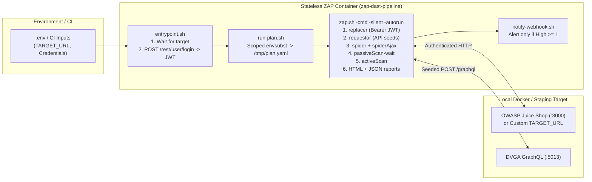

# ZAP DAST Pipeline (`zap-dast-pipeline`)

[](https://github.com/Martined27/zap-dast-pipeline/actions/workflows/scan.yml)
[](https://github.com/Martined27/zap-dast-pipeline/actions/workflows/image-scan.yml)
[](LICENSE)

A Dockerized, stateless **OWASP ZAP** dynamic application security testing (DAST) pipeline driven declaratively by the **ZAP Automation Framework**. It authenticates against a target application (SPA/REST or GraphQL), injects session tokens across all crawler/scanner threads, executes classic + headless browser (`spiderAjax`) discovery and active vulnerability scanning, and publishes HTML/JSON reports with severity-gated webhook alerting.

---

## Key Capabilities

- **Declarative ZAP Automation Framework YAML:** Full scan lifecycle (`replacer` → `requestor` → `spider` → `spiderAjax` → `passiveScan-wait` → `activeScan` → `report` → `exitStatus`) executed via `zap.sh -cmd -silent -autorun`.
- **Zero-Stall Headless Startup:** Required ZAP add-ons (`automation`, `spiderAjax`, `reports`, `replacer`, `graphql`, `requestor`) are baked into the image at build time and invoked with `-silent` so runtime never stalls on marketplace checks.
- **Authenticated SPA & API Scanning:** Automatically obtains a Bearer JWT from JSON login endpoints (or accepts a pre-issued token), injects it into every request via ZAP `replacer` rules, and seeds key API/GraphQL routes via `requestor`.
- **Scoped Template Rendering (`envsubst`):** Renders environment variables into a temporary copy of the YAML plan using a strict variable allowlist so ZAP's internal placeholders remain intact.
- **Signal-Over-Noise Alerting:** `scripts/notify-webhook.sh` parses the JSON report and posts a summary to Slack/Discord/webhook **only when High-severity findings (`riskcode >= 3`) are detected**.
- **Supply-Chain Gate:** GitHub Actions builds the runner image and scans it with **Trivy** (`HIGH` reported, unfixed library `CRITICAL` fails the build).

---

## Architecture



See [docs/architecture.md](docs/architecture.md) and [docs/auth-notes.md](docs/auth-notes.md) for deep dives on token handling and SPA route seeding.

---

## Quick Start

### 1. Run the One-Command Local Demo (OWASP Juice Shop)
Starts a local [OWASP Juice Shop](https://github.com/juice-shop/juice-shop) container on an isolated Docker bridge network, authenticates a scanner account, runs the full ZAP Automation Framework plan, and writes HTML + JSON reports to `./reports/`:

```bash
make build
make demo
```

### 2. Scan Your Own Deployed Web App (Staging / Preview)
Point the runner at any staging or preview URL you own without editing the YAML plan:

```bash
# Unauthenticated or pre-existing Bearer token scan:
make scan TARGET_URL=https://staging.my-webapp.com

# Authenticated scan with JSON login endpoint:
make scan TARGET_URL=https://staging.my-webapp.com \
          AUTH_LOGIN_URL=https://staging.my-webapp.com/api/login \
          AUTH_EMAIL=qa@my-webapp.com \
          AUTH_PASSWORD=secret
```

*(You can also trigger an on-demand scan against a custom `target_url` directly from the GitHub Actions **Run workflow** UI in [`.github/workflows/scan.yml`](.github/workflows/scan.yml)).*

### 3. Run the Seeded GraphQL Scan (DVGA)
Starts a local [Damn Vulnerable GraphQL Application](https://github.com/dolevf/Damn-Vulnerable-GraphQL-Application) container and seeds `POST /graphql` queries and mutations before active scanning:

```bash
make scan-graphql
```

---

## Sample Scan Output (Local OWASP Juice Shop Run)

Full sample HTML report committed at [`docs/sample-report/juice-shop-scan.html`](docs/sample-report/juice-shop-scan.html).

- **Discovery:** Classic Spider found `305` URLs (`00:15`); Headless Browser AJAX Spider found `1,088` URLs (`02:00`).
- **Active Scan Duration:** `05:03` (`4` threads/host, `1` min max per rule).
- **Summary Counts:** **3 High · 4 Medium · 5 Low · 3 Informational**

| Risk | Alert | Instances | Sample Flagged Endpoint |
| :--- | :--- | :---: | :--- |
| **High** | SQL Injection | 1 | `GET /rest/products/search?q=%27%28` |
| **High** | External Redirect | 1 | `GET /redirect?to=https%3A%2F%2F...owasp.org...` |
| **High** | Off-site Redirect | 1 | `GET /redirect?to=https://github.com/juice-shop/juice-shop` |
| **Medium** | Content Security Policy (CSP) Header Not Set | 5 | `GET http://juice-shop:3000` |
| **Medium** | Cross-Domain Misconfiguration (CORS) | 5 | `GET /api/Feedbacks/` |
| **Medium** | Missing Anti-clickjacking Header | 3 | `GET /socket.io/?EIO=4&transport=polling...` |
| **Medium** | Session ID in URL Rewrite | 5 | `GET /socket.io/?EIO=4&transport=polling...` |
| **Low** | Application Error Disclosure | 11 | `GET /api` |
| **Low** | Private IP Disclosure | 1 | `GET /rest/admin/application-configuration` |
| **Low** | Timestamp Disclosure - Unix | 5 | `GET /api/Products` |
| **Low** | X-Content-Type-Options Header Missing | 5 | `GET /socket.io/?EIO=4&transport=polling...` |

---

## Configuration Reference

| Variable | Default | Description |
| :--- | :--- | :--- |
| `TARGET_URL` | `http://juice-shop:3000` | Base URL of the application under test |
| `PLAN_FILE` | `plans/scan-juice-shop.yaml` | ZAP Automation Framework YAML plan template |
| `AUTH_LOGIN_URL` | `http://juice-shop:3000/rest/user/login` | Optional JSON login endpoint to fetch a Bearer token before scanning |
| `AUTH_EMAIL` | `zap-scanner@example.com` | Test account email/username |
| `AUTH_PASSWORD` | `ZapScanner!2026` | Test account password |
| `AUTH_HEADER_NAME` | `Authorization` | Request header injected by the ZAP `replacer` job |
| `ZAP_AUTH_HEADER_VALUE` | *(auto-fetched)* | Explicit header value (e.g. `Bearer <JWT>`) if skipping `AUTH_LOGIN_URL` |
| `SPIDER_MAX_DURATION_MINS` | `2` | Max duration (minutes) for the classic HTML spider |
| `AJAX_SPIDER_MAX_DURATION_MINS` | `2` | Max duration (minutes) for the headless browser AJAX spider |
| `REPORT_NAME` | `zap-scan-report` | Output filename prefix in `./reports/` (`.html` and `.json`) |
| `WEBHOOK_URL` | *(empty — disabled)* | Optional Slack/Discord/webhook URL for High-severity alerts |
| `ALERT_MIN_RISK` | `3` (`High`) | Minimum ZAP `riskcode` required to trigger a webhook notification |

---

## Limitations & What I'd Improve Next

1. **Multi-Role Differential Scanning:** Currently each run executes under a single authenticated session (`ZAP_AUTH_HEADER_VALUE`). Next iteration would run two contexts in parallel (e.g., `customer` vs. `anonymous` or `admin`) to automate Broken Access Control / IDOR detection via ZAP's Access Control add-on.
2. **OpenAPI / HAR Importing:** While `requestor` seeds high-value REST and GraphQL operations, importing an OpenAPI spec (`openapi` add-on) or a Cypress-generated `.har` file would automatically cover 100% of backend routes exercised by E2E functional suites.
3. **Token Refresh Mid-Scan:** For targets with short-lived JWTs (<15 minutes), moving token acquisition from `entrypoint.sh` into a ZAP HttpSender/Authentication script would refresh expired tokens mid-scan.

---

## License

[MIT](LICENSE) © 2026 Martin De Leon
