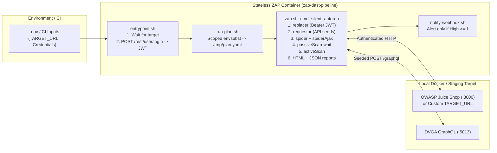

# Architecture & Pipeline Design

`zap-dast-pipeline` runs **OWASP ZAP** as a stateless, one-shot container driven declaratively by the **ZAP Automation Framework** (`-cmd -silent -autorun`).

## Key Design Decisions

1. **Declarative Automation Framework YAML (No Daemon / REST API Orchestration):**
   Instead of starting ZAP in daemon mode and polling its REST API from external Python/Bash scripts, the entire scan lifecycle is declared in `plans/scan-juice-shop.yaml` and executed in a single `zap.sh -cmd -silent -autorun` invocation.
2. **Pre-installed Add-ons + `-silent` Startup:**
   ZAP's default startup checks the online marketplace for add-on updates, which can stall or hang headless CI runs. `Dockerfile` runs `scripts/install-addons.sh` during `docker build` to bake in `automation`, `spiderAjax`, `reports`, `replacer`, `graphql`, and `requestor`, and always invokes ZAP with `-silent`.
3. **Scoped `envsubst` Rendering:**
   `scripts/run-plan.sh` passes an explicit variable allowlist (`${TARGET_URL}`, `${ZAP_AUTH_HEADER_VALUE}`, etc.) to `envsubst` so ZAP's internal template tokens survive untouched.
4. **Signal-Over-Noise Webhook Alerting:**
   `scripts/notify-webhook.sh` parses the generated `traditional-json` report with `jq` and only posts to `WEBHOOK_URL` when `riskcode >= 3` (High) findings exist.
